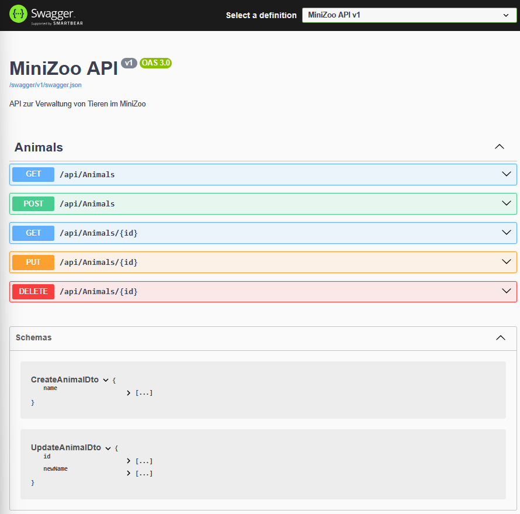
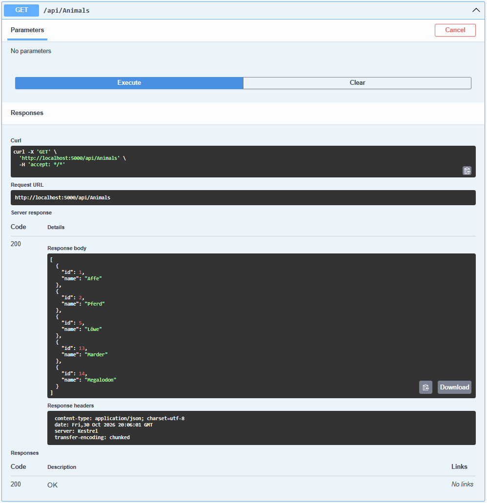

# MiniZooApi

A small ASP.NET Core Web API test project for learning and experimenting with RESTful APIs in C#.

The project demonstrates basic CRUD operations for managing animals in a mini zoo.

## Technologies

- C# / ASP.NET Core (.NET 8)
- Entity Framework Core
- SQLite database
- Swagger UI for API testing
- DTOs for create and update requests

## Features

- Retrieve all animals or a specific animal
- Add new animals
- Update existing animals
- Delete animals
- Store data in a local SQLite database

## Getting Started

1. Clone the repository.
2. Open `MiniZooApi.sln` in Visual Studio.
3. Build and run the project.
4. Open the localhost URL in your browser to access Swagger UI.
5. Test the available API endpoints.

## Screenshots

### Swagger UI

### GET Animals

## Purpose

This is a simple learning and experimentation project, not a production-ready application. Its purpose is to practice REST API development, HTTP methods, routing, DTOs, database access, and API testing with Swagger.
